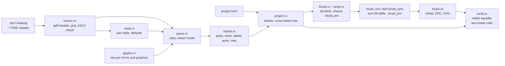
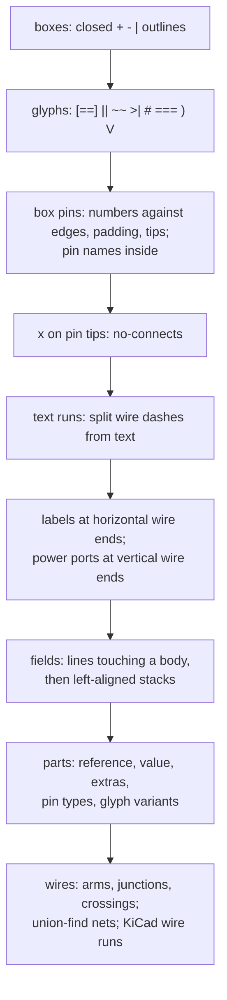

# Architecture

## Parse order

Each stage claims cells; a claimed cell is invisible to later stages, which
is how the one-element-per-cell rule is enforced.

## Coordinates

Cell (row, col) has its center at x = 15.24 + col x 1.27 mm,
y = 15.24 + row x 2.54 mm on the page. Every symbol is placed at angle 0 at
its origin cell (a box's top-left corner, a glyph's first cell); symbol
graphics are generated y-up relative to that cell.
